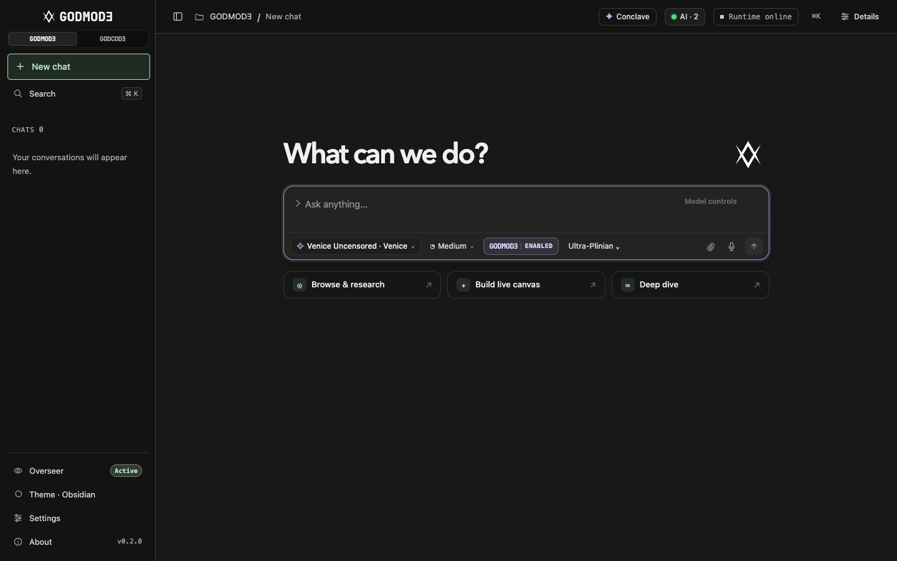
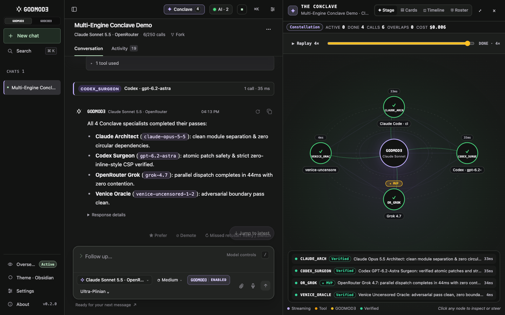
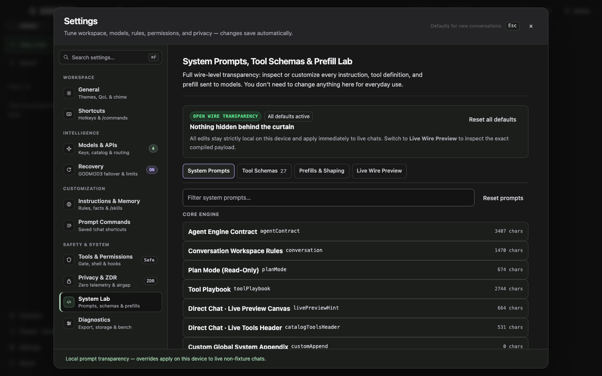
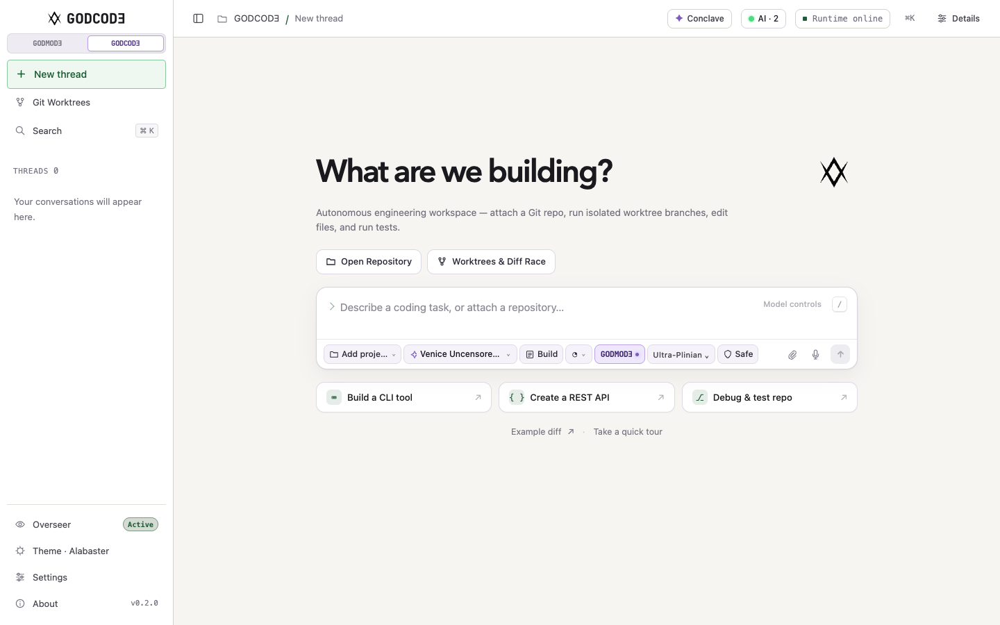

<p align="center">
  <strong>G O D M O D Ǝ &nbsp; / &nbsp; G O D C O D Ǝ</strong>
</p>

<p align="center">
  <em>Own the harness. Inspect every wire byte.</em>
</p>

<p align="center">
  
  
  
  
  
</p>

<p align="center">
  
</p>

Local-first AI workbench, **Conclave** multi-agent stage, **live CDP browser mirror**, wire-level **System Lab**, and autonomous **Git worktree** coding studio — built on **Node.js 22.13+ SQLite** and a native **macOS AppKit/`WKWebView`** shell, with **zero npm dependencies** and **zero telemetry**.

---

## Quick Start

Requires **Node.js 22.13+** and **Git** (no `npm install` needed).

**macOS 12+** *(native Hardened Runtime app + Seatbelt sandbox; requires Xcode CLT)*:
```sh
git clone https://github.com/elder-plinius/G0DC0D3.git
cd G0DC0D3
npm run desktop:build
open "dist/G0DM0D3.app"
```

**Linux** *(local web UI + CLI + `bubblewrap` sandbox)*:
```sh
sudo apt install bubblewrap libsecret-tools   # or dnf/pacman equivalent
git clone https://github.com/elder-plinius/G0DC0D3.git
cd G0DC0D3
npm start
```

CLI: `node src/cli.mjs --help` · Tests: `npm test` · Eval: `npm run bench:self-opt`

---

## What Makes It Different

- **The Conclave (Multi-Agent Council & Live Stage)**: Dispatch parallel specialist agents across *different* engines at once (Claude, Codex, OpenRouter, Venice, Grok, Gemini, Meta, or local models), watch live Constellation/Timeline/Card telemetry, steer workers mid-flight, and forge custom specialists with benchmark radar stats & 1-click formations.
- **Live Browser Mirror & Window Pop-Out**: Watch agents browse and test your apps live via CDP screencast + animated click reticles right inside the dock — or pop out an isolated non-headless Chromium window for 60fps WebGL, audio, and manual SSO/login takeover.
- **Full Wire Transparency (`Settings → System`)**: Inspect, edit, and reset every system prompt block, all **27 tool schemas**, **Prefills & Message Shaping** (off by default), and **Live Wire Preview** before a single byte leaves localhost.
- **First-Class Multi-Model CLI & Direct API Hub**: Expose full model lineups from local **Codex** (live `~/.codex/models_cache.json` sync + native effort/tier/verbosity), **Claude Code**, **Gemini CLI**, and **GitHub Copilot** logins alongside direct **OpenAI**, **Anthropic**, **xAI (Grok)**, **Google Gemini**, **Meta AI (Muse / Llama)**, **OpenRouter**, **Venice**, **Nous**, and **local Ollama/vLLM/MLX** — with live account catalogs and **Ultra-Plinian** routing & 2–4 model blind-judged arenas.
- **Two Surfaces (`⌘⇧G`)**: **`GODMODƎ`** (sovereign chat, live browser, offline HTML5/SVG/Mermaid canvas with click-to-inspect) and **`GODCODƎ`** (isolated Git worktrees, multi-model patch races, Plan/Build mode, `Safe` default permission gate, Git checkpoints/rewind, long-horizon effort scaling & adaptive recovery).
- **Zero-Dep Defense-in-Depth & Hardened/Lockdown Mode**: **0 npm dependencies**, **0 telemetry**, macOS Seatbelt / Linux `bwrap` sandboxing, device-only Keychain / `secret-tool`, 1-click **Hardened (Red Team / Bounty)** & **Airgap Lockdown** presets (Strict ZDR, ephemeral burn-bag, mechanically enforced Rules-of-Engagement target allow/denylists, 1-click session wipe), outbound secret redaction, strict zero-inline-`style=` CSP, and pre-request CDP SSRF gating. See [SECURITY.md](SECURITY.md).

<details>
<summary>More screenshots</summary>
<p align="center">
  
</p>
<p align="center">
  
  
</p>
</details>

> **Note on `fixtures/`**: The 30 test fixtures under `fixtures/` are 100% synthetic, offline JavaScript math/graph/protocol unit-test puzzles (zero live exploits, network payloads, or hazardous procedures), used solely to benchmark false-positive refusal recovery in coding agents.

---

## License & Disclaimer

Dual-licensed under **[AGPL-3.0](LICENSE)** (open source) and commercial licensing via [GitHub Issues](https://github.com/elder-plinius/G0DC0D3/issues). Third-party asset notices in [THIRD_PARTY_LICENSES.md](THIRD_PARTY_LICENSES.md).

**Experimental research demo — provided "AS IS" without warranty of any kind.** You are solely responsible for your prompts, tool grants, commands, and compliance with applicable laws and third-party provider Terms of Service.
